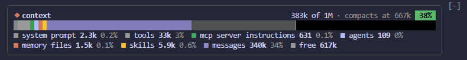

# context-bar

A Claude Code mod that draws your context window as a stacked bar above the prompt, one color per category like `/context`.



- One colored run per category (system prompt, tools, MCP tools, agents, memory files, skills, messages), then free space
- Yellow marker at the auto-compact point; the bar past it is black
- Fill badge turns green → yellow → red at 50% / 80%
- Updates at session start, after every turn, and after any slash command (`/compact`, `/clear`, `/model`)

## Install

At the Claude Code prompt:

```
/plugin install context-bar --marketplace gonekim116/context-bar
```

Answer `y` to add the marketplace, then pick the **user** scope so it loads in every session.

## Use

| | |
|---|---|
| `/context-bar` | turn the bar on / off |
| `ctrl+x ctrl+a` | collapse the band |
| click `[-]` | collapse the band (needs `/tui fullscreen`) |

Token counts are local estimates (no API calls), so they can differ slightly from `/context`.

## Update

```
claude plugin update context-bar
```

then `/reload-plugins` in an open session.

## Develop

```
claude --plugin-dir .          # run from this folder
claude plugin validate .
claude plugin test .
```
